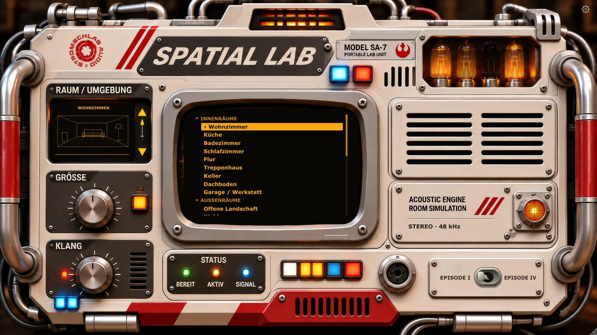
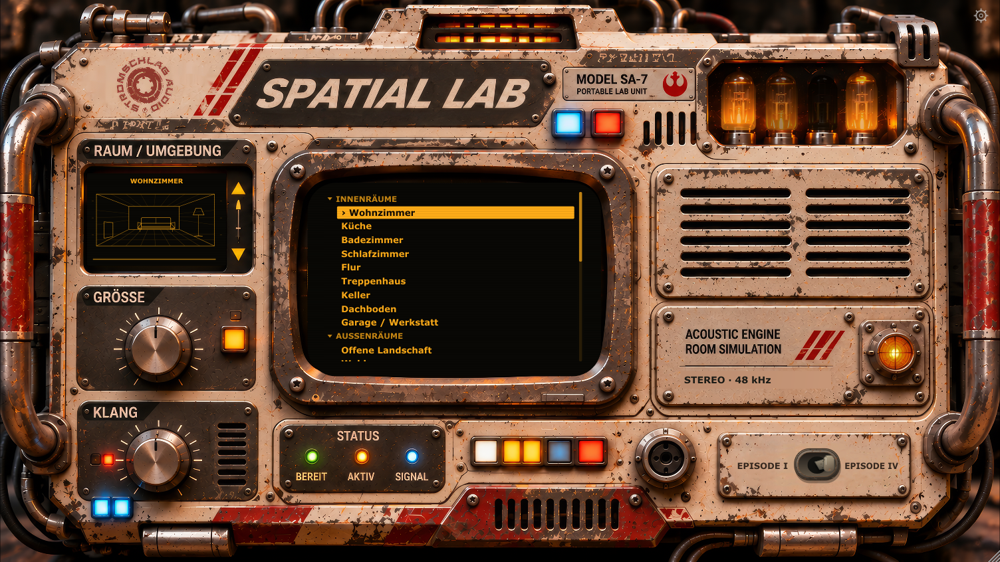
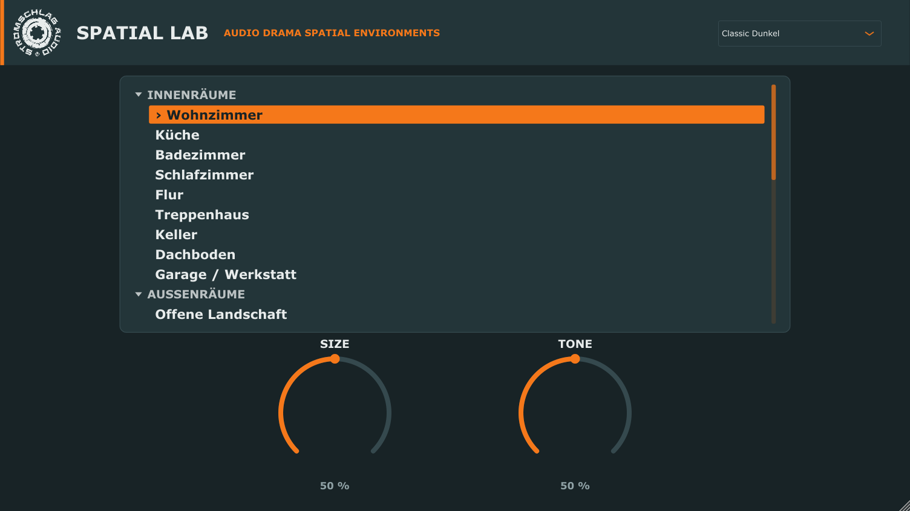
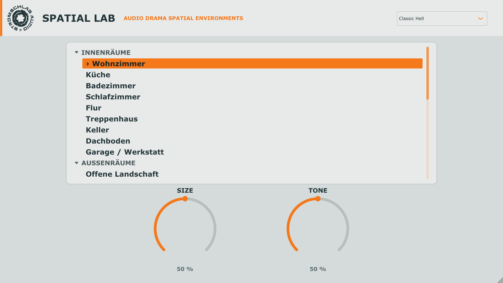

# SPATIAL LAB – Spatial Environments for Audio Drama

<picture>
  <source media="(prefers-color-scheme: dark)" srcset="docs/logo-dunkel.png">
  
</picture>

## Weniger suchen. Mehr Geschichten erzählen.

Bei der Arbeit an Hörspielen habe ich immer wieder festgestellt, wie viel Zeit allein die Suche nach dem passenden Raumklang verschlingen kann. Man klickt sich durch Hunderte oder Tausende Impulsantworten, findet endlich ein vermeintlich passendes Wohnzimmer – und merkt beim Einsetzen in die Szene, dass es überhaupt nicht nach dem Wohnzimmer klingt, das man sich vorgestellt hat. Also beginnt die Suche von vorn.

Aus diesem Frust entstand die Idee zu **SPATIAL LAB**: Statt immer neue Hallbibliotheken zu durchsuchen, wollte ich eine überschaubare Auswahl typischer Räume und akustischer Umgebungen für Hörspiele direkt griffbereit haben – vom Wohnzimmer über den Keller bis zum Wald oder zur Schlucht. Nicht als Anspruch, jeden realen Ort perfekt nachzubilden, sondern als verlässliche Ausgangspunkte, die sich mit **SIZE** und **TONE** schnell an die jeweilige Szene anpassen lassen.

Denn am Ende möchte ich meine Zeit nicht damit verbringen, den vermeintlich perfekten Hall zu suchen. Ich möchte Geschichten erzählen – und mich auf die Stimmen, Geräusche und die Atmosphäre konzentrieren, die eine Szene lebendig machen.

*SPATIAL LAB soll niemandem die Erfahrung abnehmen, Räume selbst zu gestalten. Gerade am Anfang kann es viel Spaß machen und lehrreich sein, einen Raum selbst aus Impulsantwort, Vorverzögerung, Dämpfung und Hallanteil zusammenzusetzen und zu hören, wie diese Bausteine ineinandergreifen. Ich bin dankbar, dass ich diesen Weg selbst gegangen bin, auch wenn er manchmal umständlich und mühselig war. Gerade dadurch weiß ich, was ich mir von einem Werkzeug wünsche, das all das in einem vereint. SPATIAL LAB soll das Gestalten nicht ersetzen, sondern die technische Umsetzung im Alltag einfacher machen.*

– Lars Eickstädt, Stromschlag Audio

**[SPATIAL LAB v1.1 für Windows herunterladen](https://github.com/StromschlagProductions/SpatialLab-vst/releases/tag/v1.1.0)**

[Offizielles Windows-x64-VST3-ZIP](https://github.com/StromschlagProductions/SpatialLab-vst/releases/download/v1.1.0/SpatialLab-v1.1.0-Windows-x64-VST3.zip) · [Changelog](docs/CHANGELOG.md) · [Bedienung und technische Details](docs/phase3b/PHASE3B.md)

## 26 Umgebungen, vier Kategorien

| Kategorie | Umgebungen |
|---|---|
| **INNENRÄUME** | Wohnzimmer, Küche, Badezimmer, Schlafzimmer, Flur, Treppenhaus, Keller, Dachboden, Garage/Werkstatt |
| **AUSSENRÄUME** | Offene Landschaft, Wald, Straße/Gasse, Innenhof, Schlucht/Canyon, Tunnel, Unterführung |
| **FAHRZEUGE** | Kleinwagen, großer PKW, Transporter, LKW-Kabine |
| **SPEZIALRÄUME** | Kleine Kapelle, Kathedrale, Höhle, X-Wing Cockpit, Y-Wing Cockpit, Snowspeeder Cockpit |

*Die Cockpits sind natürlich kreative Klanginterpretationen. Ich habe schließlich nicht persönlich neben Luke Skywalker im X-Wing gesessen und ihm ein Mikrofon über die Schulter gehalten. Aber ein bisschen so, wie man sich das Innere dieser Maschinen vorstellt, dürfen sie schon klingen.*

*Coming next: Darth Vader & Boba Fett Helmet.*

## Algorithmische Akustik

Die **Indoor-Engine** kombiniert frühe Reflexionen mit einem Feedback-Delay-Netzwerk für frequenzabhängig gedämpften Nachhall. Die 19 Innenraum-, Fahrzeug- und Spezialprofile besitzen individuelle Laufzeiten, Reflexionsverteilungen, Diffusion und Dämpfung.

Die separate **Outdoor-Engine** erzeugt diskrete Stereo-Reflexionen mit individuellen Verzögerungen, Pegeln, Panorama und Tiefpässen. Wo sinnvoll, ergänzt begrenztes Feedback wiederkehrende Echos. Die offene Landschaft liefert bewusst nur sehr schwache Rückwürfe; der Canyon deutlich getrennte entfernte Echos. Keine Faltung, keine externen Preset-Dateien und kein Oversampling.

SPATIAL LAB liefert **immer 100 % Wet** und ist für FX-/Send-Kanäle ausgelegt. Es gibt keinen Dry/Wet- oder Ausgangspegel-Regler. Den Effektanteil stellst du mit dem Send-Pegel in der DAW ein.

## Oberflächen

**Retro ist das ursprüngliche, charakteristische Design von SPATIAL LAB:** Episode I zeigt das fabrikneue Gerät, Episode IV die verwitterte Standardansicht. Classic Dunkel und Classic Hell sind schlichte Alternativen.

### Retro Episode I – fabrikneu



### Retro Episode IV – verwittert



### Classic Dunkel – schlichte Alternative



### Classic Hell – schlichte Alternative



Alle vier Bilder sind unveränderte echte Windows-Aufnahmen des geprüften v1.1.0-Builds. Die Classic-Ansichten zeigen SIZE/TONE im RADIOPHONE-Stil mit orangefarbenem Wertebogen und die überarbeitete Kopfzeile.

Über das Zahnrad oben rechts in Retro oder die Look-Auswahl in Classic wechselst du zwischen **Retro / Classic Dunkel / Classic Hell**. Episode I/IV wird weiterhin im Retro-Modus gewählt. Die Auswahl ist rein kosmetisch; alle Ansichten teilen dieselben Presets und Parameter. [GUI-Dokumentation und Bildherkunft](docs/classic/CLASSIC_GUI.md). Die historischen Screenshots bleiben im Repository erhalten.

## Installation

1. Die Datei **SpatialLab-v1.1.0-Windows-x64-VST3.zip** vom offiziellen Release herunterladen.
2. DAW schließen und das ZIP vollständig entpacken.
3. Den **gesamten Ordner `SpatialLab.vst3`** nach `C:\Program Files\Common Files\VST3\` kopieren. Nicht nur die innere Moduldatei kopieren.
4. DAW starten und bei Bedarf die VST3-Suche erneut ausführen.

Das Release-ZIP enthält direkt den vollständigen VST3-Ordner; ein Installer oder eine weitere ZIP-Ebene ist nicht erforderlich.

## Bedienung

- SPATIAL LAB auf einen FX-/Send-Kanal laden und die Quelle dorthin senden.
- Im großen CRT Kategorien aufklappen, mit Mausrad/Scrollleiste navigieren und ein Preset direkt anklicken. Die Pfeile links wählen den vorigen/nächsten Eintrag.
- **SIZE** verändert die wahrgenommene Größe; **TONE** den spektralen Charakter. **50 % / 50 %** ist die neutrale Ausgangsstellung. Ein Raumwechsel setzt beide Regler dorthin zurück.
- Beide Regler lassen sich ziehen, mit dem Mausrad bedienen und per Doppelklick neutral stellen.
- Send-Pegel in der DAW einstellen. Fertig.

Host-Auswahl und Session-Recall machen den aktiven Eintrag im Browser sichtbar. Klappzustände und Scrollposition werden nicht über das Schließen des Editors hinweg gespeichert. Es gibt kein Suchfeld und keine zusätzliche Tastatur-Navigation.

## System und Formate

- Windows x64, Windows 10/11 und ein kompatibler **64-Bit-VST3-Host**.
- **Microsoft Visual C++ Redistributable v14 für x64 (2015–2022)**; falls noch nicht vorhanden: [offizieller Microsoft-Installer](https://aka.ms/vs/17/release/vc_redist.x64.exe).
- Mono→Mono, Mono→Stereo und Stereo→Stereo.
- Primäre Qualitäts- und Test-Sampleraten: **44,1 und 48 kHz**. Höhere Raten sind nicht gleichwertig umfassend abgenommen.
- Fenster: mindestens **1003×565**, Standard **1504×846**, maximal **2174×1223**, proportional skalierbar. Für die vollständige Maximalansicht ist ein entsprechend großer Desktop erforderlich.
- Windows-x64-VST3 ist das bereitgestellte Format. Keine AU-, AAX-, VST2- oder Standalone-Ausgabe.

## Kompatibilität und bekannte Grenzen

Version 1.1 behält gegenüber v1.0 unverändert 26 linear kodierte Raumwerte und Session-Schema 5 bei. Ältere Test-Sessions und deren Raumautomation sind ausdrücklich nicht kompatibel; neue Sessions anlegen oder Einstellungen neu setzen. Hersteller-/Plugin-Kennungen und SIZE/TONE-IDs bleiben erhalten.

Raumwechsel blenden das Wet-Signal kurz aus und wieder ein, um harte Abrisse zu vermeiden. Raumpegel werden nicht künstlich angeglichen. Durchschnitts-CPU-Messungen sind keine Garantie für jede Hardware oder extrem kleine Audioblöcke.

Die CI prüft Layout und Eingaben bei 2174×1223. Ihr Desktop ist jedoch auf 1920×1080 begrenzt: Maximalgrößen-Bildnachweise sind dort native JUCE-Komponentenrender, keine Desktop-Screenshots. Die obigen Standardansichten sind echte Desktop-Aufnahmen.

## Entwicklung und Qualitätssicherung

C++17, JUCE **8.0.6** an festem Commit, CMake **3.31.6**, Visual Studio 2022 x64. Der Build lädt JUCE einschließlich VST3-SDK selbst; kein gesonderter SDK-Checkout nötig.

```powershell
cmake -S . -B build -G "Visual Studio 17 2022" -A x64 -DBUILD_TESTING=ON
cmake --build build --config Release --parallel 2
ctest --test-dir build -C Release --output-on-failure
```

Vollständige Windows-/GUI- und Linux-Sanitizer-Prüfungen laufen bei relevanten Pull-Request-Änderungen und gezielter manueller Abnahme. Kein doppelter Push-Trigger und keine automatische Veröffentlichung. Die bisherigen 19 Raumantworten werden gegen den eingefrorenen Vorgänger geprüft. Weitere Architektur- und Messdetails stehen in [der technischen Dokumentation](docs/phase3b/PHASE3B.md); ältere Phasenberichte sind historische Entwicklungsnachweise.

## Qualität und Prüfung

Wenige Regler heißen nicht, dass hier etwas schnell zusammengeschustert wurde. Die Einfachheit liegt in der Bedienung, nicht in der Technik dahinter. Jede Version durchläuft Prüfungen, wie sie auch bei kommerziellen Plugins üblich sind, und alles ist im Quellcode nachvollziehbar:

- **pluginval, Stufe 8:** Vor jeder Veröffentlichung läuft das Prüfprogramm pluginval von Tracktion auf strenger Stufe. Es lädt das Plugin wieder und wieder, wechselt Abtastraten und Puffergrößen, speichert und lädt Einstellungen und fährt alle Regler mit Zufallswerten durch.
- **Automatische Tests der Klangberechnung**, zusätzlich mit Speicher- und Fehlerprüfern (AddressSanitizer, UndefinedBehaviorSanitizer), die auch seltene Programmierfehler aufspüren.
- **Echtzeitsicher:** Während der Wiedergabe wird kein Speicher angefordert und nirgends gewartet. Das verhindert Aussetzer und Knackser, auch bei kleinen Puffern und vielen Instanzen.
- **Geprüfte Räume:** Alle 26 Umgebungen werden mit Referenz-Impulsantworten verglichen, die Oberfläche hat eigene Tests.
- **Gemessene Rechenlast:** Benchmarks über alle Räume, beide Abtastraten, Mono und Stereo sowie Presetwechsel.

Ob es gut klingt, entscheidet am Ende das Ohr. Deshalb geht jede Version auch durch den Studioalltag von Markus Hildebrandt (siehe unten).

## Beta-Test und Danke

**SOUNDJOB / Markus Hildebrandt** – Beta-Testing

Ein großes Dankeschön an **Markus Hildebrandt** von SOUNDJOB. Markus betreibt ein eigenes Tonstudio und hat weit mehr Hörspiele produziert als ich. Er hat SPATIAL LAB im Studioalltag getestet und mir ehrliches, fachkundiges Feedback gegeben. Seine Hinweise zu Außenräumen, also wenig Hall und dafür deutliche, einzelne Echos, stecken in der eigenen Outdoor-Engine. Dafür danke ich ihm sehr: Seine Erfahrung hat das Plugin spürbar besser gemacht.

---

## Hinweis / Disclaimer

**Open Source · Work in Progress**

Dieses Plugin wurde in erster Linie für meinen persönlichen Workflow bei der Hörspielproduktion entwickelt. Es ist auf meine eigenen Anforderungen zugeschnitten und muss daher nicht für jeden Anwendungsfall geeignet sein.

Das Projekt wird laufend weiterentwickelt. Trotz sorgfältiger Tests können Fehler oder Kompatibilitätsprobleme auftreten. Die Software wird ohne Gewährleistung bereitgestellt; die Nutzung erfolgt auf eigene Verantwortung. Eine Haftung für mögliche Schäden oder Datenverluste wird, soweit gesetzlich zulässig, ausgeschlossen. Es gelten die jeweiligen Lizenzbedingungen.

**Feedback, Fehlermeldungen und Verbesserungsvorschläge sind herzlich willkommen!**

Wenn dieses kleine Werkzeug auch anderen die Hörspielarbeit erleichtert und mehr Raum für Geschichten und menschliche Kreativität schafft, freut mich das ganz besonders.
