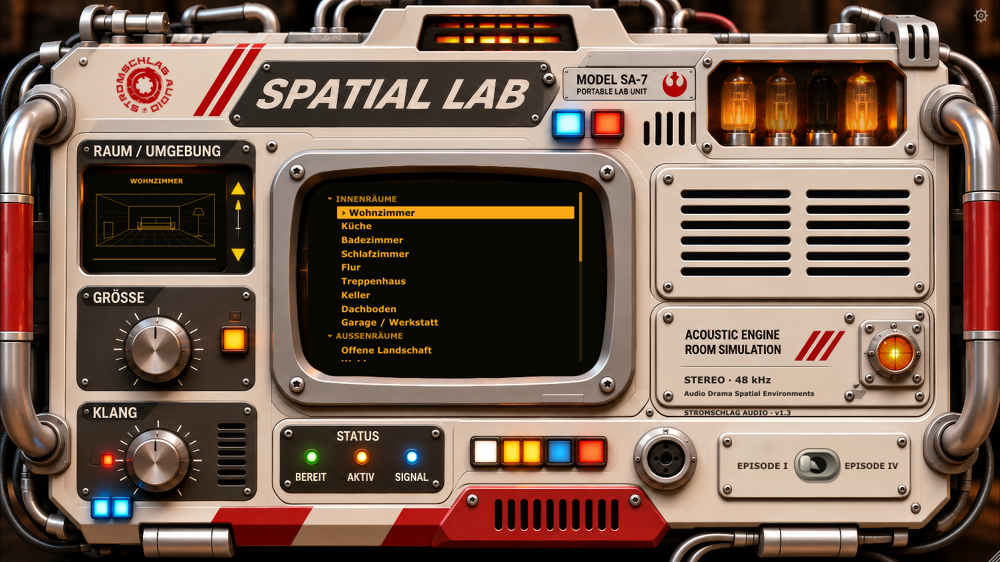
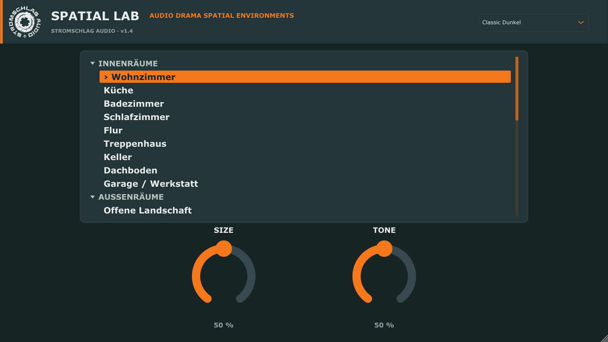
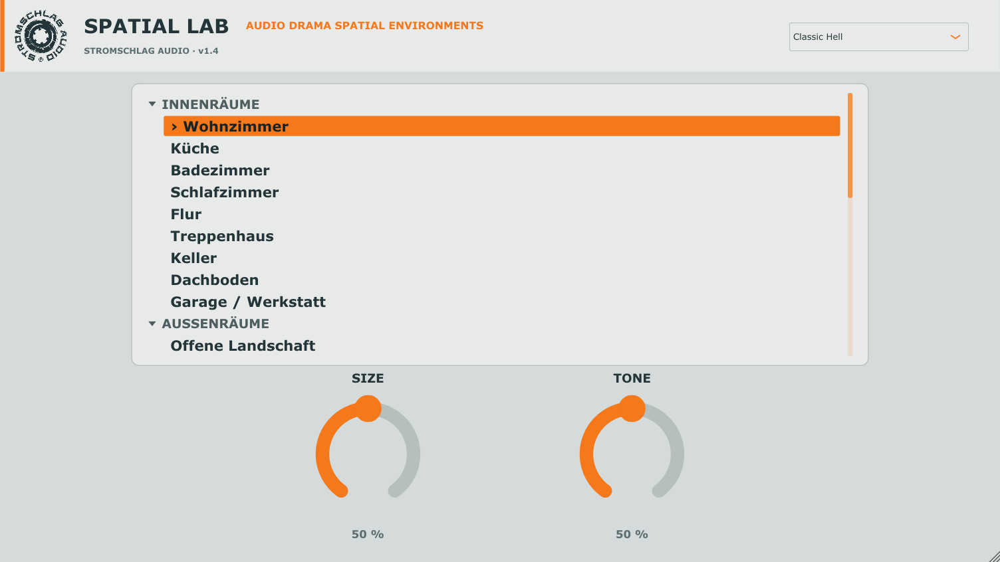

# SPATIAL LAB – Audio Drama Spatial Environments

## Oberflächen in Version 1.3

Retro ist das ursprüngliche Gerätedesign. Episode IV bleibt die Standardansicht. Classic Dunkel und Classic Hell sind schlichte Alternativen mit denselben Presets und Parametern. Alle vier aktuellen Bilder sind unveränderte native Windows-Aufnahmen des Produktionseditors, jeweils 1504 × 846 Pixel. Herkunft und Prüfsummen stehen im [Screenshot-Manifest](../screenshots.json), die vollständige Abnahme im [Versionsbericht](../v1.3/UPDATE.md).

### Retro Episode I – fabrikneu

### Retro Episode IV – verwittert

### Classic Dunkel – schlichte Alternative

### Classic Hell – schlichte Alternative

## Produktkennung

Classic zeigt SPATIAL LAB und AUDIO DRAMA SPATIAL ENVIRONMENTS nebeneinander, darunter STROMSCHLAG AUDIO · v1.3. Retro ergänzt dieselben Produktangaben im Metadatenbereich unterhalb der tatsächlichen Bus-/Sampleratenanzeige. Die Versionsanzeige wird automatisch aus CMake erzeugt; intern lautet die VST3-Version 1.3.0, öffentlich 1.3. Originalfrontplatten und Logo bleiben unverändert.

## Bedienung und Speicherung

Das Zahnrad rechts oben in Retro beziehungsweise die Look-Auswahl in Classic öffnet Retro / Classic Dunkel / Classic Hell. Der Episode-I/IV-Schalter bleibt im Retro-Modus. Look und Episode werden als getrennte GUI-Präferenzen gespeichert und verändern weder Audio-State noch Host-Automation.

Alle Ansichten verwenden denselben PresetBrowser mit 26 Umgebungen in vier Kategorien, denselben SIZE-/TONE-Reglern und denselben Parameter-Attachments. Die Classic-Regler behalten den RADIOPHONE-artigen orangefarbenen Wertebogen und die runde Positionsmarkierung. Neutrale Reglerstellung: 50 % / 50 %. Ausschließlich 100 % Wet, kein zusätzlicher Audioregler.

Standardgröße 1504 × 846, Minimum 1003 × 565, Maximum 2174 × 1223, proportional skalierbar. Retro behält CRT, Röhren und beide zusätzlichen Glimmstellen. Classic zeichnet nur bei Änderungen; keine zusätzlichen Timer oder Hintergrundberechnungen.

## Prüfung und Bildherkunft

Der Windows-Prüfhost erfasst den tatsächlich gebauten JUCE-Editor über native Desktop-Aufnahmen. Das Artefakt SpatialLab-Classic-Looks enthält Retro-Episode-I sowie Look-0 (Retro IV), Look-1 (Dunkel), Look-2 (Hell). Tools/package_branding_screenshots.py kopiert diese PNGs bytegleich und erstellt das Manifest. Keine Nachzeichnung, Montage, Skalierung oder nachträglich eingefügte Beschriftung. Historische Screenshots bleiben erhalten.

Die automatisierten GUI-Tests prüfen Look-/Episode-Wechsel, unveränderten Audio-State, samplegleiches Audio, alle 26 Presets, drei Größen und getrennte Persistenz. Hash-Prüfungen schützen den v1.2-DSP, AudioProcessor, Parameter-/Preset-Definitionen, Originalfrontplatten und Logo. Vollständige Windows-/Linux-Abnahme und pluginval Level 8 bleiben Voraussetzung der Veröffentlichung. [Aktueller Nachweis](../v1.3/UPDATE.md).

## Historische Abnahmen

Die folgenden Nachweise und historischen Dateien bleiben als Entwicklungshistorie erhalten; aktuelle Downloads und Screenshots stehen oben.

## Finale Prüfnachweise für v1.1.0

- [Vollständige Windows-/Linux-Abnahme](https://github.com/StromschlagProductions/SpatialLab-vst/actions/runs/44047686119): beide Jobs erfolgreich. Alle sechs Windows-CTest-Tests bestanden, Linux ASan/UBSan bestanden, unveränderte Originalgrafiken und DSP-Dateien sowie Hersteller-/VST3-IDs geprüft. Bestehende Retro-Lichtprüfungen, 52 Umgebungsaufnahmen und DSP-Messvergleiche ebenfalls erfolgreich.
- [pluginval Level 8](https://github.com/StromschlagProductions/SpatialLab-vst/actions/runs/44047686119/artifacts/14311794682) erfolgreich.
- [Herkunftsnachweis und Testzusammenfassung](https://github.com/StromschlagProductions/SpatialLab-vst/actions/runs/44047686119/artifacts/14313177559): getesteter Build-Commit `28fc8331b3f17491cf29abd5275e5f463cb9dabb`, Version 1.1.0. Alle Build-Eingaben auf `main` stimmen mit diesem Build überein; diese Bildkorrektur betrifft ausschließlich README, Dokumentation und zusätzliche Screenshots.
- [Geprüftes Windows-x64-VST3-Paket](https://github.com/StromschlagProductions/SpatialLab-vst/actions/runs/44047686119/artifacts/14313272251). SHA-256 des inneren Installations-ZIP: `a4dd1a8ade87b633310c6abefaacafecdaa60060fe9228152067f75685a4ac30`.

## Historische erste Classic-Abnahme

Code-Stand: `81f9dc1c2b6ec1e5a1a66cc8e43022b7789e29aa`.

- [Windows-/Linux-Abnahme vollständig erfolgreich](https://github.com/StromschlagProductions/SpatialLab-vst/actions/runs/44039981196): Windows-VST3 kompiliert, Identitätsprüfung und CTest bestanden; Linux ASan/UBSan bestanden. Auch sämtliche bestehenden Retro-Lichtprüfungen, 52 Umgebungsaufnahmen, Maximum-Größenprüfungen, Impulsantwortvergleiche und Messschritte sind erfolgreich.
- [pluginval-Protokolle](https://github.com/StromschlagProductions/SpatialLab-vst/actions/runs/44039981196/artifacts/14309830273): pluginval 1.0.4, Strictness Level 8, Ergebnis `SUCCESS` am gebauten VST3.
- [Drei echte Windows-Screenshots](https://github.com/StromschlagProductions/SpatialLab-vst/actions/runs/44039981196/artifacts/14309940204): `Look-0` Retro mit Zahnrad, `Look-1` Classic Dunkel, `Look-2` Classic Hell. Jeweils `Windows-Editor-Screenshot.png` mit 1504×846 Pixeln, zusätzlich der direkte JUCE-Komponentenrender. Original-Logo, Lesbarkeit, Regler und Zahnrad wurden an diesen Aufnahmen geprüft.

Lokal bestanden alle vier Release-DSP-Tests und der unveränderte Release-Dateienvergleich. Der zusätzliche Linux-GUI-Lauf im provisorisch bereitgestellten Xvfb brach mit `BadAtom / X_ChangeProperty` ab; dessen Abbruchmeldungen sind kein bestandener Leak-Test. Die GUI-Abnahme erfolgt daher auf Windows. Der bestehende Windows-Test prüft unter anderem Editor-Lifecycle und geschlossene Instanzen; pluginval ersetzt keinen Langzeit-Leak-Test in jeder DAW.

[Windows-x64-Testpaket herunterladen](https://github.com/StromschlagProductions/SpatialLab-vst/actions/runs/44039981196/artifacts/14309651791). Das Actions-Artefakt enthält `SpatialLab-VST3-Windows.zip`; dieses enthält ausschließlich den vollständigen Ordner `SpatialLab.vst3` mit `Contents/x86_64-win/SpatialLab.vst3` und `Contents/Resources/moduleinfo.json`. Beide ZIP-Ebenen wurden heruntergeladen und auf CRC-Integrität und vollständige Ordnerstruktur geprüft. SHA-256 des inneren Installations-ZIP: `e82113fefc2f67f2c1056fdd2a7a7b3f46d1a1b3686ade1cfa594ab7b9b0d765`.

Installation wie beim bestehenden Plugin: den vollständigen Ordner nach `C:\Program Files\Common Files\VST3\` kopieren und die DAW neu scannen lassen. Da dies dieselbe Plugin-Identität ist, ersetzt das Testpaket die bisherige Installation; bei Bedarf vorher sichern. Actions-Downloads benötigen eine GitHub-Anmeldung und sind zeitlich befristet.

Die abschließende Bedienprüfung in der eigenen DAW bleibt sinnvoll; eine Freigabe durch den Anwender wird nicht vorweggenommen.

## Offizielle Veröffentlichung

[SPATIAL LAB v1.1.0](https://github.com/StromschlagProductions/SpatialLab-vst/releases/tag/v1.1.0) wurde als stabile Version veröffentlicht. [Windows-x64-VST3-ZIP](https://github.com/StromschlagProductions/SpatialLab-vst/releases/download/v1.1.0/SpatialLab-v1.1.0-Windows-x64-VST3.zip). Der [erfolgreiche Veröffentlichungsworkflow](https://github.com/StromschlagProductions/SpatialLab-vst/actions/runs/44053161338) hat erfolgreiche Windows-/Linux-Abnahme, CTest und pluginval Level 8, Version, main-Zugehörigkeit, bytegleiche Build-Eingaben, ZIP-Integrität und VST3-IDs geprüft. Die veröffentlichte Asset-Prüfsumme entspricht dem oben dokumentierten geprüften Paket. Für diesen reinen Dokumentations- und Screenshot-Nachtrag war kein neuer Plugin-Build erforderlich.
