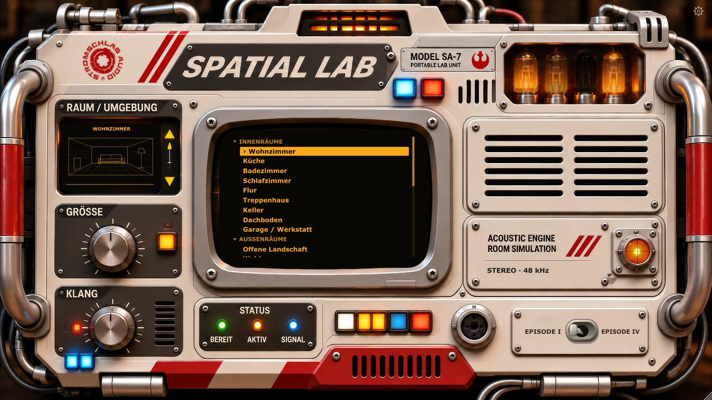
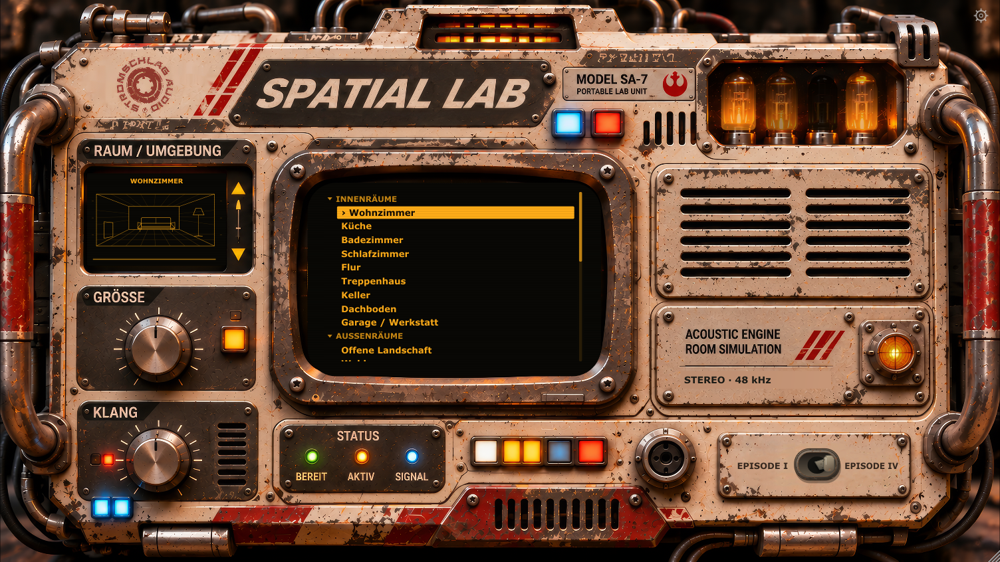
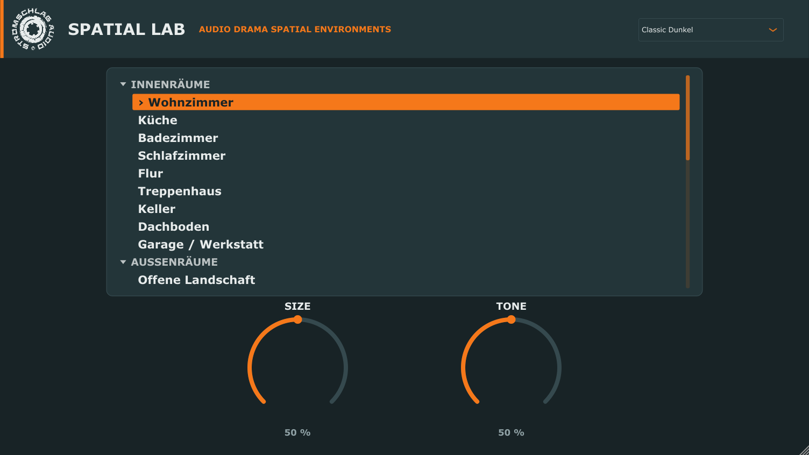
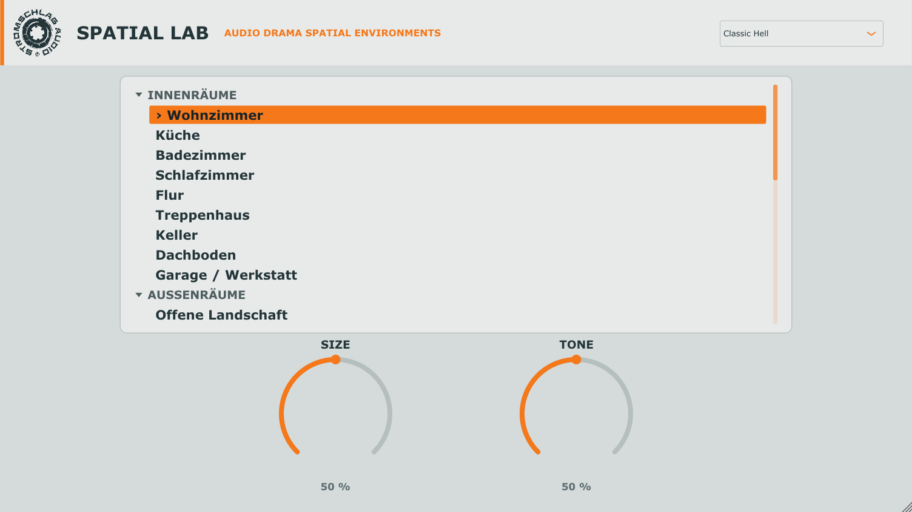

# Oberflächen von SPATIAL LAB

Version 1.1.0 bietet Retro sowie Classic Dunkel und Classic Hell im selben Plugin. PR #4 wurde nach erfolgreicher Abnahme nach `main` übernommen. [SPATIAL LAB v1.1 ist offiziell veröffentlicht](https://github.com/StromschlagProductions/SpatialLab-vst/releases/tag/v1.1.0).

## Oberflächen direkt vergleichen

Die Retro-Skins sind das ursprüngliche, charakteristische Gerätedesign: zuerst Episode I, dann Episode IV. Danach folgen Classic Dunkel und Classic Hell als schlichte Alternativen. Alle Aufnahmen stammen aus dem [vollständig erfolgreichen v1.1.0-Prüflauf 44047686119](https://github.com/StromschlagProductions/SpatialLab-vst/actions/runs/44047686119) und haben nativ 1504 × 846 Pixel.

### Retro Episode I – fabrikneu

### Retro Episode IV – verwittert

### Classic Dunkel – schlichte Alternative

### Classic Hell – schlichte Alternative

Die Classic-Aufnahmen zeigen die finalen RADIOPHONE-artigen Drehregler mit orangefarbenem Wertebogen und den Untertitel rechts neben SPATIAL LAB. Die Retro-Aufnahmen zeigen beide Skins mit dem Look-Zahnrad oben rechts.

### Bildherkunft

| Ansicht | CI-Artefakt | Originalpfad im Artefakt |
|---|---|---|
| Retro Episode I | SpatialLab-Phase3B-Screenshots | Episode-I/Room-0/Windows-Editor-Screenshot.png |
| Retro Episode IV | SpatialLab-Phase3B-Screenshots | Episode-IV/Room-0/Windows-Editor-Screenshot.png |
| Classic Dunkel | SpatialLab-Classic-Looks | Look-1/Windows-Editor-Screenshot.png |
| Classic Hell | SpatialLab-Classic-Looks | Look-2/Windows-Editor-Screenshot.png |

Die vier PNGs unter `docs/classic/screenshots/v1.1.0/` wurden bytegleich aus diesen Artefakten übernommen und visuell geprüft. Keine Neuzeichnung, Simulation, Bildbearbeitung, Skalierung oder neuer Plugin-Build. Die historischen Dateien unter `docs/classic/screenshots/` und `docs/release-v1/screenshots/` bleiben unverändert erhalten.

## Bestandsaufnahme und Wiederverwendung

SpatialLabEditor besitzt bereits die beiden Slider samt SliderParameterAttachments, PresetBrowser, die unabhängige Episode-Präferenz und einen Editor-Timer. Diese Instanzen bleiben bestehen. Die Erweiterung ergänzt ausschließlich einen Look-Zustand und alternative Anordnung/Zeichnung im selben Editor. Kein eigener Classic-Prozessor, keine separaten Parameter, keine Änderungen an AudioProcessor, Raumkatalog, DSP oder Audio-State.

Gestalterische Referenz: [Locations-vst PluginEditor.cpp](https://github.com/StromschlagProductions/Locations-vst/blob/d6a1a565842c23b313878d111e57c0aff2b1b630/Source/PluginEditor.cpp), insbesondere die Dunkel-/Hell-Paletten und Kopfzeile mit Original-Logo als Tintenmaske. Die finalen Classic-Regler folgen [RADIOPHONE](https://github.com/StromschlagProductions/Radiophone-vst/blob/f38f04eab69446891fd99b9f2b4284abadacaa53/Source/PluginEditor.cpp): JUCE V4, orangefarbener Wertebogen und runde Positionsmarkierung. Der Untertitel steht rechts neben dem Titel; seine Position folgt der tatsächlichen Titelbreite. Farben zentral in ClassicTheme.h; keine separate Hell-/Dunkel-Implementierung.

## Bedienung

Retro bleibt Standard für bestehende Einstellungen. Ein kleines Zahnrad rechts oben im freien Hintergrund öffnet Retro / Classic Dunkel / Classic Hell. Der vorhandene Episode-I/IV-Schalter bleibt ausschließlich im Retro-Modus und unverändert an seiner bisherigen Position.

Classic zeigt dieselbe Look-Auswahl in der Kopfzeile, das originale Stromschlag-Audio-Logo, SPATIAL LAB und einen Untertitel. Darunter arbeitet derselbe PresetBrowser mit allen 26 Räumen in vier Kategorien, Wheel, Schieber, Direktwahl und Host-Synchronisierung. Die beiden vorhandenen Drehregler stehen unter dem Browser. Ihre Werte und Attachments bleiben unverändert; kein neuer Audioparameter.

Der Look wird als reiner GUI-Schlüssel `look` (0 Retro, 1 Dunkel, 2 Hell) in der bisherigen PropertiesFile gespeichert. Die separate Episode-Einstellung bleibt erhalten. Fenstergröße und proportionale Skalierung bleiben für alle Looks gleich (1003×565 bis 2174×1223, Standard 1504×846). Eine kompaktere unabhängige Classic-Fenstergröße wird bewusst nicht eingeführt; damit bleibt die vorhandene Größen-/Hostlogik bestehen.

Röhren, Glut und Raumzeichnungen werden nur im Retro-Modus gezeichnet. Classic benötigt keine Animation und zeichnet nur bei Änderungen neu. Der vorhandene Timer wird für Parameter-/Host-Synchronisierung weiterverwendet; keine neuen Timer oder Hintergrundberechnungen.

## Abgrenzung und Prüfung

Tools/check_classic_scope.py sichert zwölf unveränderte Release-Dateien per SHA-256: Prozessor/State/Identität, beide Engines, Katalog, RetroMotion, GuiTelemetry, GuiPreferences sowie Originalfrontplatten und Logo. Nur Git-Zeilenenden der Quelltexte werden kanonisiert; PNGs bleiben binär unverändert. CMake ergänzt lediglich die vorhandene Logo-PNG als eingebettete GUI-Ressource, ohne Plugin-IDs zu ändern. Die offizielle Versionsnummer ist 1.1.0.

Erweiterte GUI-Tests prüfen wiederholte Look-/Episode-Wechsel, bytegleichen Audio-State und samplegleiches Audio gegenüber einer Instanz ohne Lookwechsel, 26 Direktwahlen je Look bei drei Größen, unabhängige Persistenz und unverändert drei Audio-Parameter. Bestehende Audio-/GUI-/Lichttests bleiben aktiv. Windows-CI ergänzt pluginval v1.0.4 mit festem Paket-Hash und strictness level 8 sowie echte Desktop-Aufnahmen der drei Looks.

## Finale Prüfnachweise für v1.1.0

- [Vollständige Windows-/Linux-Abnahme](https://github.com/StromschlagProductions/SpatialLab-vst/actions/runs/44047686119): beide Jobs erfolgreich. Alle sechs Windows-CTest-Tests bestanden, Linux ASan/UBSan bestanden, unveränderte Originalgrafiken und DSP-Dateien sowie Hersteller-/VST3-IDs geprüft. Bestehende Retro-Lichtprüfungen, 52 Umgebungsaufnahmen und DSP-Messvergleiche ebenfalls erfolgreich.
- [pluginval Level 8](https://github.com/StromschlagProductions/SpatialLab-vst/actions/runs/44047686119/artifacts/14311794682) erfolgreich.
- [Herkunftsnachweis und Testzusammenfassung](https://github.com/StromschlagProductions/SpatialLab-vst/actions/runs/44047686119/artifacts/14313177559): getesteter Build-Commit `28fc8331b3f17491cf29abd5275e5f463cb9dabb`, Version 1.1.0. Alle Build-Eingaben auf `main` stimmen mit diesem Build überein; diese Bildkorrektur betrifft ausschließlich README, Dokumentation und zusätzliche Screenshots.
- [Geprüftes Windows-x64-VST3-Paket](https://github.com/StromschlagProductions/SpatialLab-vst/actions/runs/44047686119/artifacts/14313272251). SHA-256 des inneren Installations-ZIP: `a4dd1a8ade87b633310c6abefaacafecdaa60060fe9228152067f75685a4ac30`.

## Historische erste Classic-Abnahme

Code-Stand: `81f9dc1c2b6ec1e5a1a66cc8e43022b7789e29aa`.

- [Windows-/Linux-Abnahme vollständig erfolgreich](https://github.com/StromschlagProductions/SpatialLab-vst/actions/runs/44039981196): Windows-VST3 kompiliert, Identitätsprüfung und CTest bestanden; Linux ASan/UBSan bestanden. Auch sämtliche bestehenden Retro-Lichtprüfungen, 52 Umgebungsaufnahmen, Maximum-Größenprüfungen, Impulsantwortvergleiche und Messschritte sind erfolgreich.
- [pluginval-Protokolle](https://github.com/StromschlagProductions/SpatialLab-vst/actions/runs/44039981196/artifacts/14309830273): pluginval 1.0.4, Strictness Level 8, Ergebnis `SUCCESS` am gebauten VST3.
- [Drei echte Windows-Screenshots](https://github.com/StromschlagProductions/SpatialLab-vst/actions/runs/44039981196/artifacts/14309940204): `Look-0` Retro mit Zahnrad, `Look-1` Classic Dunkel, `Look-2` Classic Hell. Jeweils `Windows-Editor-Screenshot.png` mit 1504×846 Pixeln, zusätzlich der direkte JUCE-Komponentenrender. Original-Logo, Lesbarkeit, Regler und Zahnrad wurden an diesen Aufnahmen geprüft.

Lokal bestanden alle vier Release-DSP-Tests und der unveränderte Release-Dateienvergleich. Der zusätzliche Linux-GUI-Lauf im provisorisch bereitgestellten Xvfb brach mit `BadAtom / X_ChangeProperty` ab; dessen Abbruchmeldungen sind kein bestandener Leak-Test. Die GUI-Abnahme erfolgt daher auf Windows. Der bestehende Windows-Test prüft unter anderem Editor-Lifecycle und geschlossene Instanzen; pluginval ersetzt keinen Langzeit-Leak-Test in jeder DAW.

[Windows-x64-Testpaket herunterladen](https://github.com/StromschlagProductions/SpatialLab-vst/actions/runs/44039981196/artifacts/14309651791). Das Actions-Artefakt enthält `SpatialLab-VST3-Windows.zip`; dieses enthält ausschließlich den vollständigen Ordner `SpatialLab.vst3` mit `Contents/x86_64-win/SpatialLab.vst3` und `Contents/Resources/moduleinfo.json`. Beide ZIP-Ebenen wurden heruntergeladen und auf CRC-Integrität und vollständige Ordnerstruktur geprüft. SHA-256 des inneren Installations-ZIP: `e82113fefc2f67f2c1056fdd2a7a7b3f46d1a1b3686ade1cfa594ab7b9b0d765`.

Installation wie beim bestehenden Plugin: den vollständigen Ordner nach `C:\Program Files\Common Files\VST3\` kopieren und die DAW neu scannen lassen. Da dies dieselbe Plugin-Identität ist, ersetzt das Testpaket die bisherige Installation; bei Bedarf vorher sichern. Actions-Downloads benötigen eine GitHub-Anmeldung und sind zeitlich befristet.

Die abschließende Bedienprüfung in der eigenen DAW bleibt sinnvoll; eine Freigabe durch den Anwender wird nicht vorweggenommen.

## Offizielle Veröffentlichung

[SPATIAL LAB v1.1.0](https://github.com/StromschlagProductions/SpatialLab-vst/releases/tag/v1.1.0) ist als neueste stabile Version veröffentlicht. [Windows-x64-VST3-ZIP](https://github.com/StromschlagProductions/SpatialLab-vst/releases/download/v1.1.0/SpatialLab-v1.1.0-Windows-x64-VST3.zip). Der [erfolgreiche Veröffentlichungsworkflow](https://github.com/StromschlagProductions/SpatialLab-vst/actions/runs/44053161338) hat erfolgreiche Windows-/Linux-Abnahme, CTest und pluginval Level 8, Version, main-Zugehörigkeit, bytegleiche Build-Eingaben, ZIP-Integrität und VST3-IDs geprüft. Die veröffentlichte Asset-Prüfsumme entspricht dem oben dokumentierten geprüften Paket. Für diesen reinen Dokumentations- und Screenshot-Nachtrag war kein neuer Plugin-Build erforderlich.
