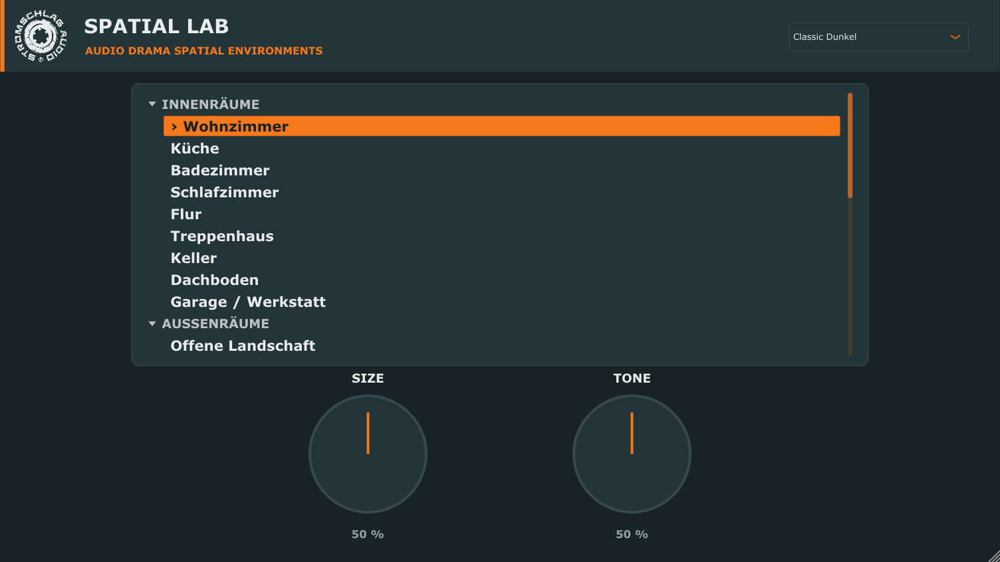
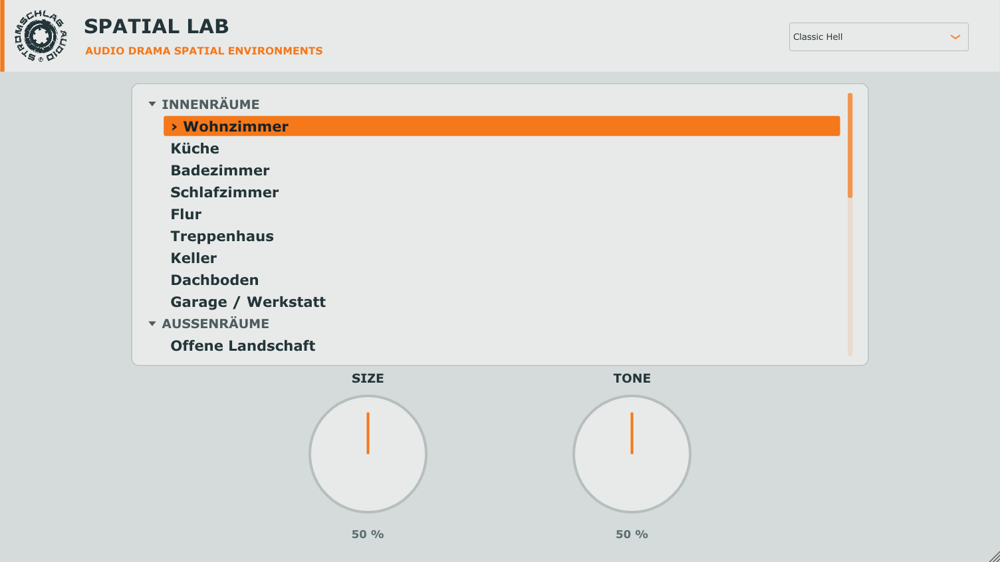

# Zusätzliche Classic-Oberfläche

Branch: feature/classic-gui. Kein zweites Plugin, kein Release und keine Zusammenführung nach main.

## Oberflächen direkt vergleichen

Unveränderte echte Windows-Screenshots aus dem [erfolgreichen CI-Lauf 44039981196](https://github.com/StromschlagProductions/SpatialLab-vst/actions/runs/44039981196), jeweils 1504 × 846 Pixel. Keine Neuberechnung, Bildbearbeitung oder Skalierung der gespeicherten PNGs.

### Retro – Episode I mit Zahnrad

Quelle: Artefakt `SpatialLab-Phase3B-Screenshots`, `Episode-I/Room-0/Windows-Editor-Screenshot.png`. Das separate Look-Paket enthält als Retro-Beispiel Episode IV; hier wird ausdrücklich Episode I gezeigt.

### Classic Dunkel

Quelle: Artefakt `SpatialLab-Classic-Looks`, `Look-1/Windows-Editor-Screenshot.png`.

### Classic Hell

Quelle: Artefakt `SpatialLab-Classic-Looks`, `Look-2/Windows-Editor-Screenshot.png`.

Die drei Dateien liegen dauerhaft in diesem Branch unter `docs/classic/screenshots/` und sind bytegleich zu den genannten CI-Aufnahmen. Die Einbettung dient der optischen Beurteilung; sie ersetzt keine persönliche Bedienprüfung in der DAW.

## Bestandsaufnahme und Wiederverwendung

SpatialLabEditor besitzt bereits die beiden Slider samt SliderParameterAttachments, PresetBrowser, die unabhängige Episode-Präferenz und einen Editor-Timer. Diese Instanzen bleiben bestehen. Die Erweiterung ergänzt ausschließlich einen Look-Zustand und alternative Anordnung/Zeichnung im selben Editor. Kein eigener Classic-Prozessor, keine separaten Parameter, keine Änderungen an AudioProcessor, Raumkatalog, DSP oder Audio-State.

Gestalterische Referenz: [Locations-vst PluginEditor.cpp](https://github.com/StromschlagProductions/Locations-vst/blob/d6a1a565842c23b313878d111e57c0aff2b1b630/Source/PluginEditor.cpp), insbesondere die Dunkel-/Hell-Paletten und Kopfzeile mit Original-Logo als Tintenmaske. Farben zentral in ClassicTheme.h; keine separate Hell-/Dunkel-Implementierung.

## Bedienung

Retro bleibt Standard für bestehende Einstellungen. Ein kleines Zahnrad rechts oben im freien Hintergrund öffnet Retro / Classic Dunkel / Classic Hell. Der vorhandene Episode-I/IV-Schalter bleibt ausschließlich im Retro-Modus und unverändert an seiner bisherigen Position.

Classic zeigt dieselbe Look-Auswahl in der Kopfzeile, das originale Stromschlag-Audio-Logo, SPATIAL LAB und einen Untertitel. Darunter arbeitet derselbe PresetBrowser mit allen 26 Räumen in vier Kategorien, Wheel, Schieber, Direktwahl und Host-Synchronisierung. Die beiden vorhandenen Drehregler stehen unter dem Browser. Ihre Werte und Attachments bleiben unverändert; kein neuer Audioparameter.

Der Look wird als reiner GUI-Schlüssel `look` (0 Retro, 1 Dunkel, 2 Hell) in der bisherigen PropertiesFile gespeichert. Die separate Episode-Einstellung bleibt erhalten. Fenstergröße und proportionale Skalierung bleiben für alle Looks gleich (1003×565 bis 2174×1223, Standard 1504×846). Eine kompaktere unabhängige Classic-Fenstergröße wird bewusst nicht eingeführt; damit bleibt die vorhandene Größen-/Hostlogik bestehen.

Röhren, Glut und Raumzeichnungen werden nur im Retro-Modus gezeichnet. Classic benötigt keine Animation und zeichnet nur bei Änderungen neu. Der vorhandene Timer wird für Parameter-/Host-Synchronisierung weiterverwendet; keine neuen Timer oder Hintergrundberechnungen.

## Abgrenzung und Prüfung

Tools/check_classic_scope.py sichert zwölf unveränderte Release-Dateien per SHA-256: Prozessor/State/Identität, beide Engines, Katalog, RetroMotion, GuiTelemetry, GuiPreferences sowie Originalfrontplatten und Logo. Nur Git-Zeilenenden der Quelltexte werden kanonisiert; PNGs bleiben binär unverändert. CMake ergänzt lediglich die vorhandene Logo-PNG als eingebettete GUI-Ressource, ohne Plugin-ID oder Version zu ändern.

Erweiterte GUI-Tests prüfen wiederholte Look-/Episode-Wechsel, bytegleichen Audio-State und samplegleiches Audio gegenüber einer Instanz ohne Lookwechsel, 26 Direktwahlen je Look bei drei Größen, unabhängige Persistenz und unverändert drei Audio-Parameter. Bestehende Audio-/GUI-/Lichttests bleiben aktiv. Windows-CI ergänzt pluginval v1.0.4 mit festem Paket-Hash und strictness level 8 sowie echte Desktop-Aufnahmen der drei Looks.

## Prüfnachweise

Code-Stand: `81f9dc1c2b6ec1e5a1a66cc8e43022b7789e29aa`.

- [Windows-/Linux-Abnahme vollständig erfolgreich](https://github.com/StromschlagProductions/SpatialLab-vst/actions/runs/44039981196): Windows-VST3 kompiliert, Identitätsprüfung und CTest bestanden; Linux ASan/UBSan bestanden. Auch sämtliche bestehenden Retro-Lichtprüfungen, 52 Umgebungsaufnahmen, Maximum-Größenprüfungen, Impulsantwortvergleiche und Messschritte sind erfolgreich.
- [pluginval-Protokolle](https://github.com/StromschlagProductions/SpatialLab-vst/actions/runs/44039981196/artifacts/14309830273): pluginval 1.0.4, Strictness Level 8, Ergebnis `SUCCESS` am gebauten VST3.
- [Drei echte Windows-Screenshots](https://github.com/StromschlagProductions/SpatialLab-vst/actions/runs/44039981196/artifacts/14309940204): `Look-0` Retro mit Zahnrad, `Look-1` Classic Dunkel, `Look-2` Classic Hell. Jeweils `Windows-Editor-Screenshot.png` mit 1504×846 Pixeln, zusätzlich der direkte JUCE-Komponentenrender. Original-Logo, Lesbarkeit, Regler und Zahnrad wurden an diesen Aufnahmen geprüft.

Lokal bestanden alle vier Release-DSP-Tests und der unveränderte Release-Dateienvergleich. Der zusätzliche Linux-GUI-Lauf im provisorisch bereitgestellten Xvfb brach mit `BadAtom / X_ChangeProperty` ab; dessen Abbruchmeldungen sind kein bestandener Leak-Test. Die GUI-Abnahme erfolgt daher auf Windows. Der bestehende Windows-Test prüft unter anderem Editor-Lifecycle und geschlossene Instanzen; pluginval ersetzt keinen Langzeit-Leak-Test in jeder DAW.

[Windows-x64-Testpaket herunterladen](https://github.com/StromschlagProductions/SpatialLab-vst/actions/runs/44039981196/artifacts/14309651791). Das Actions-Artefakt enthält `SpatialLab-VST3-Windows.zip`; dieses enthält ausschließlich den vollständigen Ordner `SpatialLab.vst3` mit `Contents/x86_64-win/SpatialLab.vst3` und `Contents/Resources/moduleinfo.json`. Beide ZIP-Ebenen wurden heruntergeladen und auf CRC-Integrität und vollständige Ordnerstruktur geprüft. SHA-256 des inneren Installations-ZIP: `e82113fefc2f67f2c1056fdd2a7a7b3f46d1a1b3686ade1cfa594ab7b9b0d765`.

Installation wie beim bestehenden Plugin: den vollständigen Ordner nach `C:\Program Files\Common Files\VST3\` kopieren und die DAW neu scannen lassen. Da dies dieselbe Plugin-Identität ist, ersetzt das Testpaket die bisherige Installation; bei Bedarf vorher sichern. Actions-Downloads benötigen eine GitHub-Anmeldung und sind zeitlich befristet.

Kein öffentlicher Release und kein Merge. Die abschließende Bedienprüfung in der eigenen DAW bleibt sinnvoll; eine Freigabe durch den Anwender wird nicht vorweggenommen.
