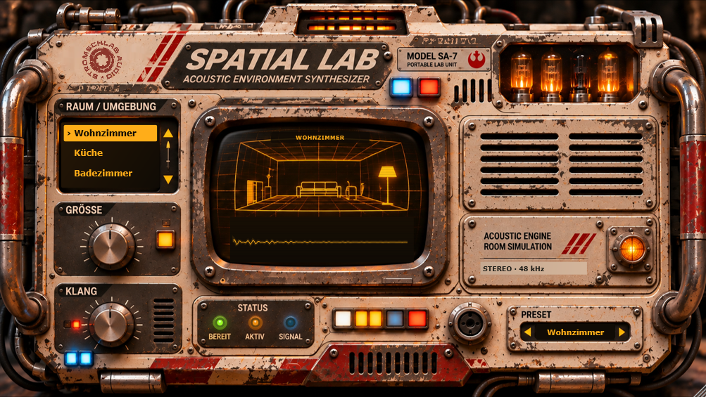

# Prüfbilder der implementierten JUCE-Oberfläche

Code-Stand: `6d490fc6019ba3352ba761ab02b247cde2d5f456`.
[Erfolgreicher Windows-/Linux-CI-Lauf](https://github.com/StromschlagProductions/SpatialLab-vst/actions/runs/43733243192).
[Originales Build-Artefakt mit VST3 und Bildern](https://github.com/StromschlagProductions/SpatialLab-vst/actions/runs/43733243192/artifacts/14169382572).

Die Dateien wurden unverändert aus diesem CI-Artefakt übernommen. Es fand keine Pixelbearbeitung, Montage oder Bildgenerierung statt. Der native Prüfhost öffnete denselben Editor wie die VST3 und speiste ausschließlich für die Vorschau synthetisches Audio in den bestehenden Prozessor. Gezeigt: Wohnzimmer, neutrale Größe/Klang, Stereo, tatsächlich vorbereitete 48 kHz. Das Original-Logo erscheint als dunkelroter Siebdruck auf lokal rekonstruierter Metalltextur; die bisherige Metallplakette ist entfernt.

| Datei | Nachweis | Abmessungen |
| --- | --- | --- |
| [Windows-Editor-Screenshot.png](Windows-Editor-Screenshot.png) | **Echter Bildschirm-Screenshot** der sichtbaren Editorfläche, Windows/GDI-BitBlt | 1003×565 |
| [JUCE-Editor-Render-100.png](JUCE-Editor-Render-100.png) | `createComponentSnapshot`, 100 % | 1003×565 |
| [JUCE-Editor-Render-125.png](JUCE-Editor-Render-125.png) | `createComponentSnapshot`, 125 % | 1254×706 |
| [JUCE-Editor-Render-150.png](JUCE-Editor-Render-150.png) | `createComponentSnapshot`, 150 % | 1504×848 |

Die drei Render sind direkt vom Produktionseditor gezeichnet, aber **keine Bildschirmfotos bei drei unterschiedlichen Windows-DPI-Einstellungen**. Reale DAW-/DPI-Prüfungen bleiben Teil der manuellen Abnahme. Die Bilder wurden visuell auf nahtlose Logo-Integration, Ausrichtung und Lesbarkeit geprüft; sie belegen keine Hör-/DAW-Freigabe.

Im selben Lauf bestanden unverändert die bisherigen DSP- und Prozessor-Tests, die neuen GUI-Isolationstests und die Linux-Sanitizer. Die PNG-Prüfung bestätigt Abmessungen, CRCs und genau eine Aufnahme pro Datei.

SHA-256 des echten Screenshots: `8a00e35d799d3ae7bb25fa3cf382644ffacc12ef17e13021c59c72f96203fe4c`.

Der neue echte Screenshot wurde mit dem Screenshot aus `32f4d8a` verglichen: Alle Pixel außerhalb des Logo-Bereichs und der bereits vorhandenen animierten CRT-Signalspur sind identisch. Die Signalspur zeigt aufgrund unterschiedlicher Aufnahmezeitpunkte eine andere Animationsphase; deren Code wurde nicht geändert. Audiocode, Parameter, Messwertpfad, Bedienflächen und sonstige GUI-Logik sind gegenüber `32f4d8a` unverändert.
